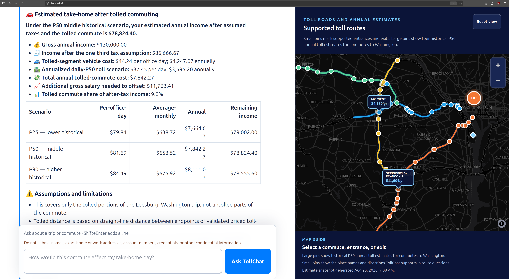
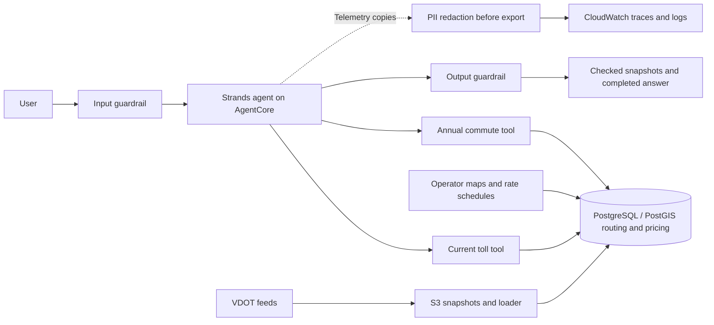
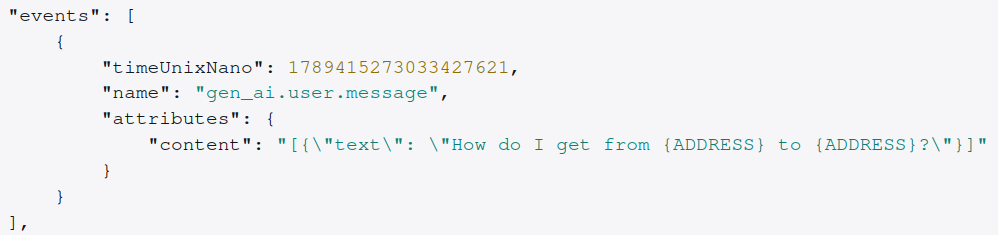
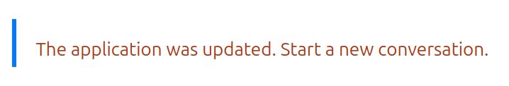

# TollChat

**One engineer, an AI software factory, and a human on every decision.** Label a GitHub issue and the factory builds it on a branch in an isolated sandbox, has a separate session review it, and opens a pull request that CI checks. Only I merge. TollChat, a Northern Virginia toll-pricing chat agent, is the production application the factory builds and maintains.

[How the factory works](#how-the-factory-works) · [Factory controls](#factory-controls) ·
[Factory plan](v2/plans/FACTORY-PLAN.md) · [TollChat live demo](https://tollchat.ai/) ·
[Engineering evidence](#engineering-evidence) · [Technical guide](v2/README.md)

## How the factory works

1. **Intake.** Adding the `factory` label to an issue triggers [a workflow](.github/workflows/factory-dispatch.yml) that starts a managed-agent session for that issue. The issue body and my comments are the spec; other comments are evidence, never requirements.
2. **Build.** A worker session in a [sandbox](factory/sandbox/) writes an end-to-end test first, confirms it fails for the reported reason, makes the change, runs the checks the sandbox supports, and pushes a branch. [Its definition](factory/agents/worker.md) tells it to choose the likeliest intent where the issue is open and to list each choice as an assumption.
3. **Grade and review.** A grader reruns the checks in the worker's sandbox against [a rubric](factory/rubrics/worker.md); a branch that misses it stops there. A separate [reviewer session](factory/agents/reviewer.md) that has not seen the worker's reasoning then checks the branch once. The worker fixes the findings it agrees with and rebuts the rest.
4. **Pull request and CI.** The [dispatcher](factory/dispatch.py) opens the pull request. Required CI, run through one entry point ([`verify.sh`](.github/scripts/verify.sh)), decides whether it can merge. Failing logs go back to the worker as evidence.
5. **Merge.** I review and merge. The factory never merges, pushes to `main`, or moves tags.

The factory's own nightly [documentation agent](factory/agents/docs.md) fixes Markdown statements the code proves false. [The factory's README](factory/README.md) explains each piece and run with diagrams. Design history is in the [factory plan](v2/plans/FACTORY-PLAN.md) and the earlier [local-runner spec](v2/plans/FACTORY-SPEC.md), which it replaced.

## Factory controls

Each row links a claim to its implementation and a way to inspect it. These controls limit what the factory can do; they do not prove its output is correct.

| Claim | Implementation | Verification evidence | Status / limits |
| --- | --- | --- | --- |
| The factory cannot change the files that govern it or production | [Guard](factory/host/guard.py) rejects pull requests touching protected paths such as infrastructure, workflows, `factory/`, and `CLAUDE.md` | [Guard tests](factory/host/test_guard.py) and the [guard workflow](.github/workflows/factory-guard.yml) | Changes to those paths need a human-authored pull request. |
| Closing keywords, secrets, and manifest edits are screened | [Guard](factory/host/guard.py) checks commit messages, scans for secrets, and limits release-manifest edits | [Guard tests](factory/host/test_guard.py) | Pattern-based; it catches known shapes only. |
| Agent sandboxes reach only an allowlist of hosts | [Egress rules](factory/sandbox/egress.nft) and the [proxy allowlist](factory/proxy/allowlist.py) | [Proxy tests](factory/host/test_proxy.py) and [sandbox spawn tests](factory/host/test_sandbox_spawn.py) | The sandbox is isolated from production credentials; the host holds the GitHub login. |
| Each role has its own narrow definition | [Worker, reviewer, and docs agents](factory/agents/) | Each definition's `tools` list, applied by [Factory Sync](.github/workflows/factory-sync.yml) | The reviewer reports and cannot push. |
| One dispatcher admits and sequences work | [Dispatcher](factory/dispatch.py) admits only issues I wrote and labelled, then runs the build, the review, the pull request and the CI rounds | [Dispatcher tests](factory/test_dispatch.py) | One run per issue at a time; a rerun waits until the last run's pull request is closed and its branch deleted. |
| Every run is visible | The [dispatcher](factory/dispatch.py) reports how each run ended on its issue, linking the worker's and reviewer's sessions and, for a finished run, its cost | [Dispatcher tests](factory/test_dispatch.py) | Each run's rubric result is on the issue; the grader sees the sandbox, not the transcript. |
| Rules are enforced by checks, not prose | [`CLAUDE.md`](CLAUDE.md) lists each rule beside the check that enforces it; [`verify.sh`](.github/scripts/verify.sh) runs them | [Documentation tests](v2/tests/test_documentation.py) | Judgment calls that no check covers go to me. |

**Limits.** A human approves every merge. Review by another model session is a second opinion, not a proof. Checks that need AWS or the deployed app run only in CI.

## The product: TollChat

[Cost dashboard](https://tollchat.ai/cost-dashboard) · Daily AWS and OpenAI billing; per-answer cost is not yet measured.

**A deployed AI application with separate development and production environments, deterministic pricing tools, input and output guardrails, and PII redaction before trace export.**

**[Experiment journal: how I test and improve the agent](v2/journal/EXPERIMENT_JOURNAL.md)**
Follow the hypotheses, baseline comparisons, measured results, costs, limitations, and decisions behind changes to TollChat.

## Engineering evidence

Each row links a claim to its implementation and a way to inspect or verify it. Tests describe checked behavior; workflow definitions describe delivery controls. Neither alone proves a successful live deployment. Recorded results below retain their original scope.

| Claim | Implementation | Verification evidence | Status / limits |
| --- | --- | --- | --- |
| Separate development and production environments | [Development backend](infra/backend.development.hcl), [production backend](infra/backend.production.hcl), and [account contract](infra/account-contract.json) | [Foundation contract tests](v2/tests/test_infrastructure_foundation.py) and [delivery documentation](v2/README.md#verify-the-build) | Separate account/state configuration; release evidence is specific to an artifact and run. |
| Reviewed, reproducible delivery | [Development delivery](.github/workflows/v2-development-delivery.yml), [production release](.github/workflows/v2-production-release.yml), and [production plan/apply](.github/workflows/v2-production-plan.yml) | [Release checks](v2/tests/test_check_production_release.py), [plan workflow tests](v2/tests/test_production_plan_workflow.py), and [operator runbook](v2/RUNBOOK.md) | Production delivery checks the candidate and saved plan and requires protected review. PR checks use disposable database validation. |
| Blue-green delivery protects release and conversation boundaries | [Release controller](v2/scripts/release_blue_green.py) and [chat proxy](v2/lambdas/chat_proxy/handler.mjs) | [Deployment tests](v2/tests/test_blue_green.py), [session isolation tests](v2/lambdas/chat_proxy/handler.test.mjs), and [browser restart tests](v2/tests/test_public_chat_ui.mjs) | Separate production cutover approval; retained release for recovery. Sessions restart across releases. See the [deployment runbook](v2/runbooks/blue-green-deployments.md). |
| The model delegates route validation and money arithmetic to deterministic tools | [Current toll tool](v2/agent_tools/get_current_toll_price.py), [annual commute tool](v2/agent_tools/get_annual_toll_ballpark.py), and [routing contract](v2/db/oracle/CONTRACT.md) | [Tool contract tests](v2/tests/test_tool_contract.py) and [historical live-check summary](v2/journal/pages/2026-08-17.md#august-22-live-integration-checks) | Tools own pricing; generated explanations still need grounding evaluation. |
| Guardrails check inputs, streamed assistant snapshots, and completed answers | [Runtime checks](v2/agent/agentcore_entrypoint.py) and [versioned guardrail policy](v2/infra/agentcore.tf) | [Input/output blocking and safe-failure tests](v2/tests/test_agentcore_entrypoint.py) and [live release gates](v2/scripts/check_development_release.py) | Configured content, prompt-attack, and credential protections reduce abuse risk; they do not guarantee prevention. |
| Detected PII is redacted from telemetry before export | [Telemetry exporter](v2/agent/telemetry.py) and [additional masking and alarms](v2/infra/trace_redaction.tf) | [Redaction and failure-path tests](v2/tests/test_telemetry_redaction.py), [observed trace example](#observed-trace-redaction), and [verification runbook](v2/runbooks/telemetry-pii-redaction.md) | Detection can miss information. Redaction failures omit affected content; the screenshot demonstrates one address-redaction example. |
| Runtime access and credentials have explicit boundaries | [Runtime IAM permissions](v2/infra/agentcore.tf), [database roles](v2/db/roles.sql), and [security policy](SECURITY.md) | [IAM contract tests](v2/tests/test_infrastructure_iam.py) and [database validation instructions](v2/README.md#verify-the-build) | IAM-authenticated database access; deployed credentials live in SSM Parameter Store. |
| v1.2.0 was compared with the agent it replaced (holdout since retired) | [Release scorecard](v2/agent/assets/releases.html), live at [tollchat.ai/release-dashboard](https://tollchat.ai/release-dashboard) | [Holdout procedure](https://github.com/rhprasad0/nova-toll-budget-agent/blob/2181e7e2fffbc3576f0093c86fa0da796deddc18/v2/eval/GOLDEN_RUNNER.md#external-holdout-checkpoints) and [experiment journal](v2/journal/pages/2026-10-12.md#october-15-compare-the-v120-candidate-with-the-production-agent-on-holdout) | v1.2.0 and v1.1.2 ran on the same 25 holdout cases, five runs each. The holdout is not blind, and only aggregate results are published. |

## Architecture and safety

The agent resolves intent and helps users choose supported entrances and exits. It can call exactly two tools. The tools validate directed routes, apply schedules and freshness rules, and return pricing components and totals. The model cannot submit its own route plan or pricing components.

The public interface uses CloudFront and WAF. Inside the runtime, the input check runs before the agent. Each streamed assistant-text snapshot and the completed answer pass an output check before delivery; tool activity can also stream. Guardrail errors return a safe failure response.

Telemetry uses a separate guardrail. It scans copies of diagnostic content without changing the active conversation or tool results. If redaction times out, fails, or cannot process content safely, the exporter substitutes an omission marker. CloudWatch masking adds another layer, but does not erase underlying originals. See the [privacy notice](v2/agent/privacy.txt) for processing and retention limits.

### Observed trace redaction

*Supplied trace capture: both addresses appear as `{ADDRESS}` in a `gen_ai.user.message` event.*

The visible message is `How do I get from {ADDRESS} to {ADDRESS}?`. This is evidence of address redaction in this trace, not a measurement of detection coverage across PII types or environments. Automated detection can miss information; the [telemetry runbook](v2/runbooks/telemetry-pii-redaction.md) describes synthetic verification across export destinations.

### Source-backed routing and pricing

Northern Virginia has four distinct pricing systems: I-66 Inside the Beltway, the I-95/I-395/I-495 Express Lanes, Dulles Toll Road, and Dulles Greenway. Their dynamic prices, directional schedules, ramp charges, and cross-road connections require different rules.

I reverse-engineered VDOT feed identifiers against public calculators and operator maps to recover directed ramps, aliases, pricing keys, and cross-road handoffs. The [source mappings](v2/oracle/sources/) and [data builder](v2/oracle/build_oracle_data.py) produce the routing oracle's checked-in SQL inputs. Coordinates help identify nearby ramps; proximity alone never creates a road connection.

That work exposed 330 pricing IDs in the I-95/I-495 route map but only 314 in retained VDOT history. The missing 16 affected 107 of 685 published routes. The [proxy mapping](v2/db/analysis.sql) uses source-overlap evidence to select available price proxies and labels those prices as modeled. The [historical holdout summary](v2/journal/pages/2026-09-21.md#i-95i-495-identity-proxy-validation) documents their measured error and limitations.

## Blue-green deployments and conversation cutover

**An agent release changes both the application and the context in which a conversation runs.** I built blue-green delivery to validate the next release while the active release continues serving traffic. Candidate checks verify the actual release identity, a grounded agent answer, guardrail behavior, and trace redaction. Production requires a separate human approval before cutover, followed by fresh validation before traffic switches.

Promotion changes routing to the validated candidate and retains the previous release for recovery. During post-cutover observation, two consecutive probe failures trigger one rollback attempt. The [deployment runbook](v2/runbooks/blue-green-deployments.md) documents the validation gates and recovery procedure; public and private routing updates are not globally atomic.

**Conversation state has an explicit release boundary.** Each session carries a release ID. If a request reaches a different release—or uses a legacy session without an ID—the chat proxy rejects it before invoking or resetting AgentCore, clears the session cookie, and tells the user to start a new conversation. In-flight requests may finish, but prompts are never automatically replayed. I chose a visible restart so an existing conversation is not silently continued under a different agent release.

*The user-facing restart message when a session does not match the serving release.*

## Evaluation status

The train, shadow, holdout and scheduled evaluation suites were retired on
November 17, 2026 because they did not represent real use. Evaluation restarts
from scratch in Phoenix. Production delivery uses the artifact
provenance, protected human approvals, saved-plan, migration, and canary checks
described in the [runbook](v2/RUNBOOK.md#production-release-checks); these do
not measure agent accuracy. The [experiment journal](v2/journal/EXPERIMENT_JOURNAL.md)
records past experiments, results, costs, and decisions.

## Reproduce and inspect

- [Run the local agent](v2/README.md#local-agent-console) or try the [deployed application](https://tollchat.ai/).
- Inspect [daily AWS and OpenAI billing](https://tollchat.ai/cost-dashboard) in the cost dashboard; per-answer cost is not yet measured.
- [Build and validate](v2/README.md#verify-the-build), including disposable database checks.
- Inspect [release operations](v2/RUNBOOK.md), [telemetry verification](v2/runbooks/telemetry-pii-redaction.md), and [shared foundation changes](v2/README.md#shared-foundation-changes).

| Area | Contents |
| --- | --- |
| [`factory/`](factory/) and [`.github/scripts/`](.github/scripts/) | The software factory: dispatcher, guard, agent definitions, sandbox, and CI entry point |
| [`v2/agent/`](v2/agent/) and [`v2/agent_tools/`](v2/agent_tools/) | Agent, frontend, versioned prompt/tool contracts, and deterministic tools |
| [`v2/db/`](v2/db/), [`v2/oracle/`](v2/oracle/), and [`v2/lambdas/`](v2/lambdas/) | Database, migrations, source mappings, data ingestion, and chat proxy |
| [`v2/tests/`](v2/tests/) and [`v2/journal/`](v2/journal/) | Executable checks and recorded experiments |
| [`v2/infra/`](v2/infra/), [`infra/`](infra/), and [`.github/workflows/`](.github/workflows/) | Application/shared infrastructure and delivery workflows |

## License

Unless otherwise noted, project-authored source code and documentation are available under the [Apache License 2.0](LICENSE).
