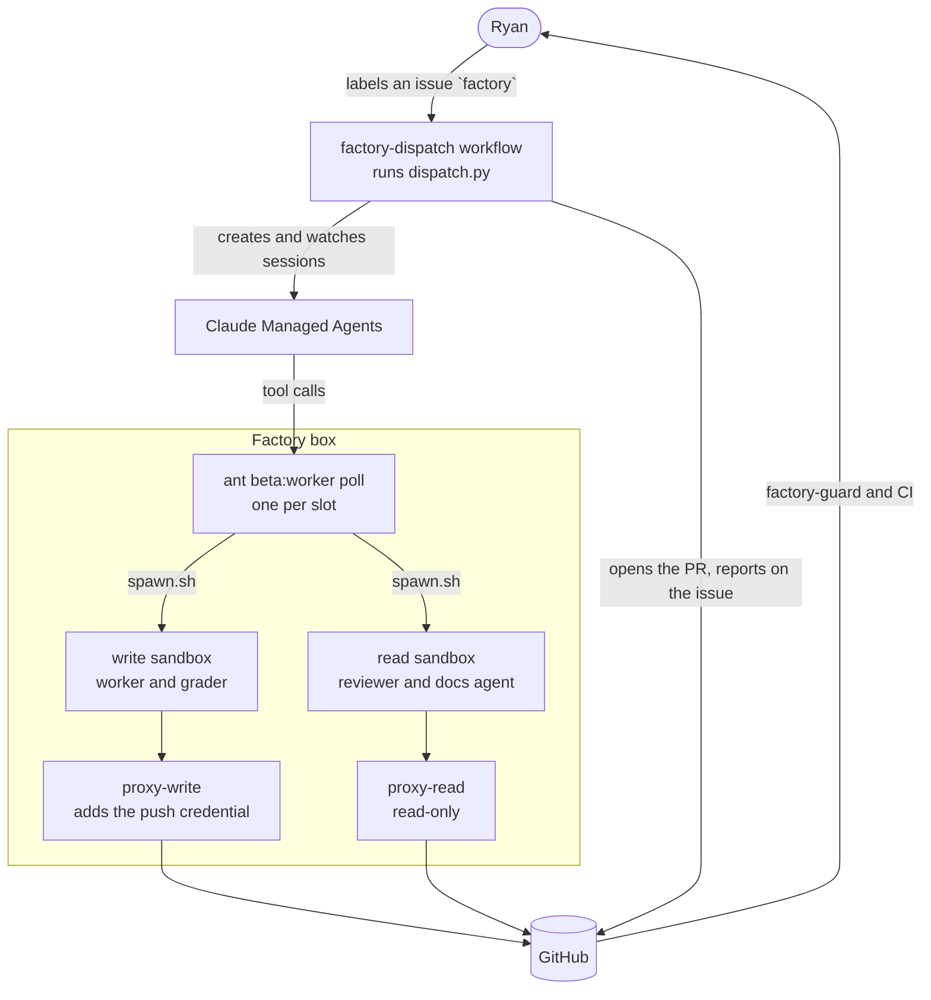
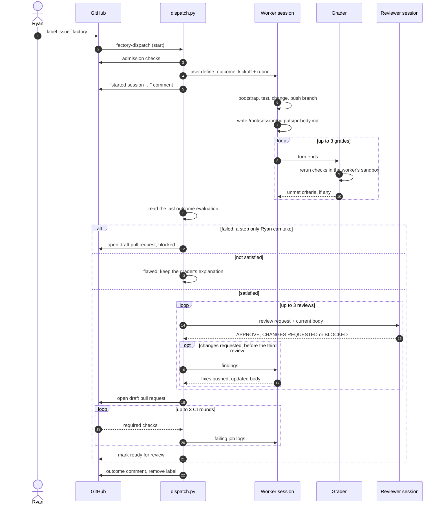
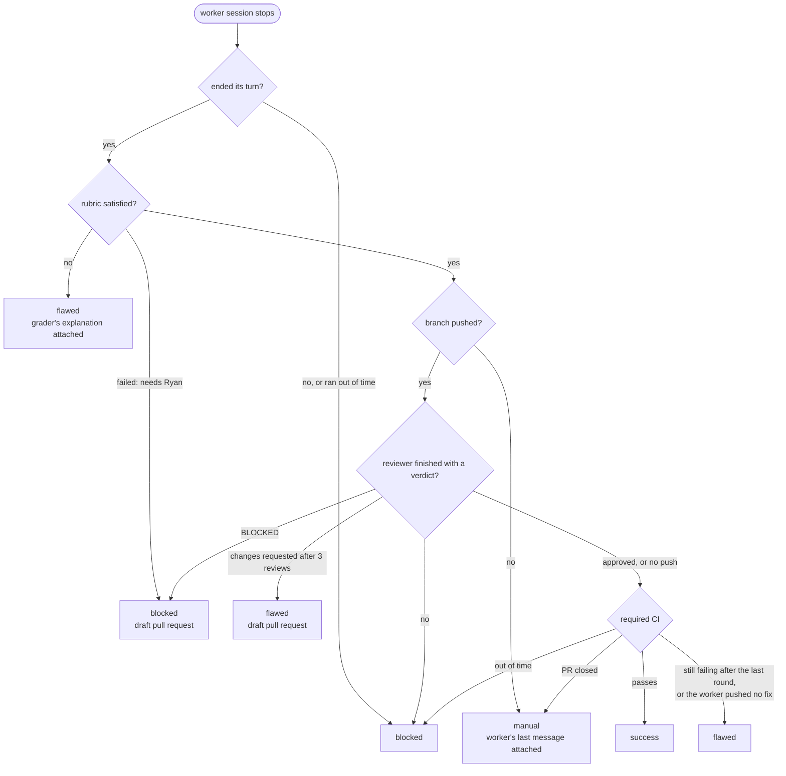

# The factory

The factory turns a GitHub issue into a pull request. Ryan labels an issue `factory`; a worker agent builds it on a branch in a sandbox, a grader checks the branch against a rubric, a separate reviewer checks it again for up to three rounds, the dispatcher opens the pull request and feeds failing CI back to the worker, and Ryan merges. The factory never merges, pushes to `main`, or moves tags.

The agents run on Claude Managed Agents. Their tools run in self-hosted sandboxes on a small machine at home, the factory box. GitHub Actions runs the dispatcher.

## The pieces



| Piece | Where | What it does |
| --- | --- | --- |
| Dispatcher | [`dispatch.py`](dispatch.py), run by [`factory-dispatch.yml`](../.github/workflows/factory-dispatch.yml) | Admits the issue, starts the worker session, waits for it, runs up to three review rounds, opens the pull request, runs CI feedback rounds, and posts the outcome on the issue. |
| Worker | [`agents/worker.md`](agents/worker.md) | Writes a failing end-to-end test, makes the change, runs what the sandbox can of CI, pushes a branch, and returns the pull request body. |
| Rubric | [`rubrics/worker.md`](rubrics/worker.md) | What the grader checks before review. |
| Reviewer | [`agents/reviewer.md`](agents/reviewer.md) | Checks the branch against the issue and `CLAUDE.md` from a session that has not seen the worker's reasoning; reports `APPROVE`, `CHANGES REQUESTED` or `BLOCKED` and changes nothing. |
| Docs agent | [`agents/docs.md`](agents/docs.md), scheduled by [`deployments/docs.yaml`](deployments/docs.yaml) | Runs nightly on `main` and opens one pull request when the code proves a Markdown statement false. Keeps notes between nights in [a memory store](memory_stores/docs.yaml). |
| Environments | [`environments/`](environments/) | Two self-hosted sandboxes: `tollchat-box-write` for the worker, `tollchat-box-read` for the reviewer and docs agent. |
| Sandbox | [`sandbox/`](sandbox/) | On the factory box, a poller per slot takes work from Managed Agents and [`spawn.sh`](sandbox/spawn.sh) starts one container per session from the [toolchain image](sandbox/Dockerfile), with a fresh clone and two disposable PostGIS databases. |
| Egress | [`sandbox/egress.nft`](sandbox/egress.nft), [`proxy/allowlist.py`](proxy/allowlist.py) | Sandbox users can reach only their proxy. The proxy allows only listed hosts and adds the GitHub credentials itself, so no sandbox holds a token. Only `proxy-write` can push. |
| Guard | [`host/guard.py`](host/guard.py), run by [`factory-guard.yml`](../.github/workflows/factory-guard.yml) | Fails a factory pull request that touches a protected path, puts a closing keyword in a commit message, or adds a secret. Protected paths include `factory/`, `.github/`, infrastructure and every `CLAUDE.md`, so the factory cannot change the rules it runs under. |
| Bootstrap | [`bootstrap.sh`](bootstrap.sh) | Each session's first step: runs `v2/scripts/setup.sh` and reports which [`verify.sh`](../.github/scripts/verify.sh) jobs the sandbox can trust. |
| Sync | [`factory-sync.yml`](../.github/workflows/factory-sync.yml) | On a push to `main` that changes an agent, environment, vault, memory store or deployment, runs `ant apply` and stores the resulting IDs in `claude-lock.json` on the `factory-state` branch, where the dispatcher reads them. |

## One run



1. **Admission.** [`admission_problem`](dispatch.py) starts a run only for an open issue that Ryan wrote and labeled, with no open pull request and no existing `factory/issue-<n>` branch. Otherwise the dispatcher says why on the issue and removes the label. The [issue template](../.github/ISSUE_TEMPLATE/factory.md) shows what a buildable issue looks like.
2. **Build.** [`start_session`](dispatch.py) starts the worker with a `user.define_outcome` event: the kickoff message is the task and [the rubric](rubrics/worker.md) is how it is graded. The worker reads the issue, writes a test that fails, makes the change, pushes, and ends its turn with the pull request body, which it also writes to `/mnt/session/outputs/pr-body.md`.
3. **Grade.** When the worker ends its turn, Managed Agents runs a grader in the worker's own sandbox. The grader sees the task, the rubric and the sandbox, not the transcript, so every criterion is something it can rerun or read: the pushed branch, the test both ways, `verify.sh quick`, the guard's protected paths, and `pr-body.md`. Unmet criteria go back to the worker, up to the dispatcher's `FEEDBACK_ROUNDS`. The session stays running until the grading ends, so the dispatcher's wait already covers it. When the worker's body starts with a `Blocked:` line naming a step only Ryan can take, the rubric tells the grader to return `failed`, which the dispatcher reports as `blocked`, opening a draft pull request without review.
4. **Review.** A reviewer session in the read sandbox reads the branch and the worker's body; the grader has already run the checks. If it requests changes, the worker fixes what it agrees with, rebuts the rest in the body and pushes, and a fresh reviewer checks the new head, up to `REVIEW_ROUNDS` reviews. Findings still open after the last review end `flawed`, and a `BLOCKED` verdict ends `blocked`; both open a draft pull request with the findings and skip CI. A round where the worker pushes nothing ends review and goes on to CI.
5. **Pull request and CI.** The dispatcher opens a draft pull request from the worker's final message, adding `Closes #<n>`. While required checks fail, it sends the failing logs to the worker, up to `FEEDBACK_ROUNDS` times. When they pass it marks the pull request ready.
6. **Report.** The dispatcher posts the outcome as a new comment, deletes its "started" comment, removes the label, and Ryan reviews.

Budgets and time limits are the defaults in [`main`](dispatch.py) and the deployment file; the workflow does not override them.

## Outcomes

Every run ends with one comment on its issue:

```
The factory's session <link> opened <pr>; required CI passed and it is ready for review.

Outcome: **success** · rubric: `satisfied` · stop reason: `end_turn` · cost: $4.12
```



| Outcome | Meaning | What to do |
| --- | --- | --- |
| `success` | The rubric was satisfied, the reviewer finished and required CI passes. The only outcome that needs Ryan's review. | Review the pull request as deeply as its Assessment's review depth says. |
| `flawed` | The agent produced the wrong thing: it missed the rubric, left review findings open after the last review, or could not make CI pass. | Read the grader's explanation, the findings or the CI rounds, then fix the issue, the prompt or the rubric and rerun. |
| `blocked` | Something outside the agent stopped it: the grader or the reviewer found a step only Ryan can take, time ran out, a session stopped early, or the reviewer gave no verdict. | Take the named step on the draft pull request, or check the linked sessions and the workflow run. |
| `manual` | A deliberate stop for a human, such as a closed pull request. | Decide what happens next. |

## Rerunning an issue

Delete the `factory/issue-<n>` branch, close any open pull request for the issue, and add the `factory` label again.

## Changing the factory

The guard protects all of `factory/`, so changes here go through an ordinary pull request, never the factory itself. When one merges, Factory Sync updates the agents, environments, vaults, memory stores and deployments it changed; the dispatcher and rubric are read from `main` on each run.

[`compose.yaml`](compose.yaml) runs the factory box's trace stack and database relays; [`guard.py`](host/guard.py) is the part every run depends on.
