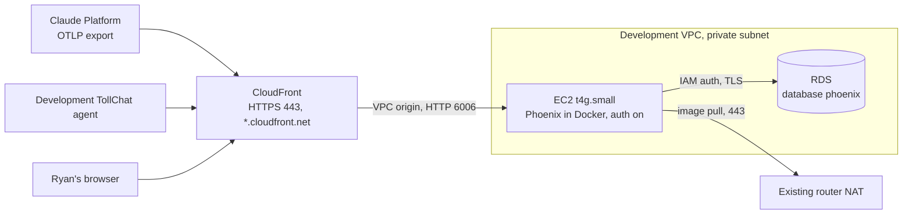

# TollChat Factory Plan

Status: **rewritten on 2026-11-16.** The factory moves from the local runner on
the thin client to Claude Managed Agents, following the
[Phoenix factory](https://github.com/Arize-ai/phoenix/tree/main/factory) as
closely as a one-lane version can. Phoenix moves off the thin client into AWS,
and both the factory and the TollChat agent send their traces to it. Nothing
below is built yet.

This plan grants no AWS, Terraform, database, or CI authority; each step that
touches those says who does it. Steps marked **Ryan** need a human at a keyboard
or a decision. Each stage ends with a check; do not start a stage until the one
before it passes.

## Why

The local runner's first real work order (#799) ended `needs_clarification`
three times. Its sandbox could not reach GitHub, so it could not read the PR the
issue pointed at, and each re-label started from the issue body alone, so it
never saw Ryan's answers in the comments. In Phoenix's design the session mounts
the repository and reads the issue and its comments itself through the GitHub
MCP server, which removes both causes.

## The parked local runner

[FACTORY-SPEC.md](FACTORY-SPEC.md) describes it, and `factory/host/`,
`factory/proxy/`, `factory/agent/`, `factory/collector/` and `factory/systemd/`
are its code. Stages 1 to 5 of the old plan were finished and Stage 6 was built
(#766, #767, #772, #773, #779, #781 to #783, #796). It stays in the repo, unused,
until Ryan decides to return to it or delete it. Stage numbers in that code's
comments refer to the plan as it stood before 2026-11-16.

State on 2026-11-16: the poller timer is stopped and disabled on the thin
client. The runner, the dashboard, and the trace stack (Phoenix, collector,
proxy, credential helper) still run there. Stage 3 stops Phoenix and the
collector; Stage 4 stops the rest.

## What is kept from Phoenix and what is dropped

| Phoenix | Here |
| --- | --- |
| Agents, environment and vault defined as files, synced with `ant apply`; `claude-lock.json` on a `factory-state` branch | Kept |
| `factory-dispatch.yml` running `dispatch.py start`, then `watch` | Kept, trimmed |
| Session mounts the repo; the kickoff message carries only the issue number; the agent reads the issue with `issue_read` | Kept |
| Session pushes `factory/issue-N` and opens a draft PR itself | Kept |
| Outcome rubric graded by `user.define_outcome`, up to 3 revisions | Kept, one rubric. `watch` treats an ungraded session as `flawed`, so the loop depends on it |
| Required CI failures sent back to the session, up to 3 rounds; PR marked ready once CI passes | Kept |
| Run outcomes `success`, `flawed`, `blocked`, `manual`, with cost, in one issue comment | Kept |
| `factory-guard.yml` as a required check | Kept, with this repo's protected paths |
| Per-session spend cap | Kept |
| `bootstrap.sh` run first in each session | Kept, for this repo's toolchains |
| Opus coordinators | Sonnet 5.5 |
| Three lanes chosen by triage labels | One lane, no lane labels |
| Subagents: reproducer, analyst, area and security reviewers | Dropped. One agent |
| GitHub App with minted installation tokens | Kept |
| Claude Code Review findings sent back | Dropped. This repo has no review workflow |
| Triage, candidates, review and finish lanes, previews, log scans, CLA check, Grafana and Datadog vaults | Dropped |

## Decisions

**Settled with Ryan on 2026-11-16:**

- API-billed spend is acceptable. Managed Agents bills tokens at API rates plus
  $0.08 per running session-hour, on the Claude Console rather than the
  subscription's limits. The subscription's monthly API credits are spent
  first; when they run out and no credit was bought, requests stop. This
  replaces the 2026-11-15 decision that a work order fits the subscription.
- The worker model is Sonnet.
- Steering follows Phoenix: there is no persistent session across labels.
  Re-adding the `factory` label starts a new session, and that session reads the
  whole issue thread, so a comment answers a question the last run asked.
- Phoenix is hosted in AWS and is reachable from the internet with
  authentication on.
- The development TollChat agent drops ADOT and the telemetry guardrail and
  exports to Phoenix only. Production stays as it is. The product is now the
  factory.
- `factory/agents/` and `factory/rubrics/` are exempt from the no-new-Markdown
  rule.
- The GitHub credential is a GitHub App, as in Phoenix, so the factory has its
  own login. Admission and the guard match on that login to tell the factory
  from Ryan.
- The factory runs in a new Claude Console organization linked to Ryan's
  subscription, in a workspace of its own. The key in SSM belongs to an old
  account and is not used.
- GitHub Actions holds no Anthropic key. It authenticates with
  [Workload Identity Federation](https://platform.claude.com/docs/en/manage-claude/wif-providers/github-actions):
  each run trades its GitHub identity token for a short-lived Anthropic token.
  One federation rule admits only this repository's runs on `main`, bound to a
  service account in the factory's workspace, so a pull request's run can never
  reach the vault. Phoenix uses a stored key; this is stricter.
- Phoenix in AWS is one EC2 instance behind CloudFront (Stage 3).
- The spend cap is $10 per session at list price.
- CI is the gate. The agent runs what the sandbox can, and failing required
  checks come back to it as feedback rounds.

**These reverse rules in the spec. Each is deliberate:**

- The sandbox now holds a token that can push. In the local runner it held no
  GitHub credential, and work left only as a bundle that a host-side guard
  checked before any push. The boundary is now what the token may do, the guard
  check on the PR, and Ryan's merge.
- The agent now reads issue comments, which anyone can write on a public
  repository. The spec used the title and body only. The agent's prompt treats
  the thread as evidence, never as instructions, and only Ryan's label starts a
  run: the App's login is never accepted as a requester.
- A pushed branch is public before any secrets scan runs. The sandbox holds no
  real secret (the vault swaps a placeholder for the token at the network edge),
  so the scan moves into the guard check as a second line.
- `factory/` becomes a protected path, as in Phoenix: its files define the
  agent, its tools and its rubric. The spec let the factory work on itself.
- Web search and web fetch are on, as in Phoenix, limited to the environment's
  allowed hosts. The spec turned them off because they bring untrusted text into
  the session; that session now also holds a push token.
- There is no cancel. Removing the label does not stop a session; the spend cap
  and the watch timeout bound it.

**Still open:**

- **The local runner's fate.** Keep it parked or delete it, with its Roles
  Anywhere role and the `factory-traces/` export.

## Stage 1: Sandbox spike

**Status on 2026-11-16: done.** Session `sesn_01Gwe7ryj7WjQHMniYZuADa3` (Sonnet
5.5, 17 minutes, $0.46 at list price) ran on `main` in the throwaway
`factory-spike` environment and agent.

- **Docker does not work.** The client is installed but no daemon runs:
  `docker info` fails on the missing `/var/run/docker.sock`.
- **PostGIS from apt works but does not help.** After `apt-get update`,
  `postgresql-16-postgis-3` installs in 17 s and gives PostGIS 3.4.2 on
  PostgreSQL 16.15. `v2/scripts/run_db_tests.sh` needs `docker inspect` and
  `docker exec` on a `postgis/postgis:17-3.5` container, so `database` cannot
  run.
- **Three setup gaps, all fixable in `bootstrap.sh` or the package list:**
  - The default `python3` and `python` are 3.11, and pyright takes its language
    version from them, so `setup.sh`, `loader` and `terraform` fail on 3.12
    syntax. Putting the shipped `/usr/bin/python3.13` first on `PATH` fixes it.
  - `xxd` and Terraform are missing. Node is 22.22.0 where CI pins 22.22.1.
    All install in seconds.
  - The mounted clone is shallow (50 commits), so one contract test cannot
    read an old commit. Fetch full history.
- **Resources:** peak memory 1.3 GB; disk use rose about 5 GB with every job
  and extra install, under the documented 10 GB. No host setup needed was
  blocked; `astral.sh` and the Docker registry were unreachable or unused.

| Job | With the fixes | Without |
| --- | --- | --- |
| `terraform` | Pass, 107 s | Fails at the 3.12 syntax |
| `loader` | Up to pytest passes; pytest 2187 passed, 2 failed in 217 s; later steps not reached | Fails at pyright |
| `factory` | 93 of 106 pass; the 13 others build Docker images | Same |
| `database` | Cannot run | Cannot run |

The two `loader` failures are the shallow clone (`git show` of an old commit)
and the timed-checks zip digest, which differed from the pin. The digest is
unexplained; the build downloaded its own CPython through uv, so a toolchain
different from CI's is the leading suspect.

**The agent runs itself:** `setup.sh`, `terraform`, `loader` through pytest,
and the non-Docker `factory` tests. **CI alone runs:** `database`, the Docker
`factory` tests, and the package builds and digests until the digest
difference is explained. Stage 4's `bootstrap.sh` carries the three fixes.

One throwaway session, started by hand with `ant` or the Console, in a `limited`
cloud environment. It runs before Stage 2, so it holds no token that can push:
the repository is public and mounts without one. CI is the gate either way; the
spike decides what `bootstrap.sh` sets up and what the agent is told it can run.

The cloud sandbox is a package list on x86 Ubuntu with 8 GB of memory and 10 GB
of disk. Its
[reference](https://platform.claude.com/docs/en/managed-agents/cloud-sandboxes-reference)
lists PostgreSQL 16, not the `postgis/postgis:17-3.5` image the `database` and
`mcp` checks use, and Docker as "limited availability".

1. **Ryan:** create the Console organization and link it to the subscription
   for its monthly API credits. The link cannot be changed without support, so
   link the organization the factory will stay in. Create the factory's
   workspace, and sign in with `ant auth login` for the spike.
2. The session runs the setup under "Verify the build" in `v2/README.md`, then
   each check in `.github/scripts/verify.sh` by name, and reports:
   - whether `docker info` works, and whether `postgis/postgis:17-3.5` pulls and
     starts, with the image registry's hosts allowed so a blocked pull is not
     mistaken for missing Docker;
   - if not, whether PostGIS installs from apt into the shipped PostgreSQL;
   - disk used after setup, against the 10 GB limit, and peak memory;
   - which checks pass, which cannot run, and how long the run took;
   - which hosts setup needed beyond the package registries.

**Done when:** the report is recorded here, with the list of checks the agent
runs itself and the list it leaves to CI.

## Stage 2: GitHub boundary

The token and the guard are the boundary now, so they are tested before any
session holds the token.

**Status on 2026-11-16: steps 1 to 3 done.** The
App is `tollchat-factory` (login `tollchat-factory[bot]`), installed on this
repository only with Contents, Issues and Pull requests write and Metadata read,
and no webhook. Its private key is the secret `FACTORY_APP_PRIVATE_KEY` in a
`factory` environment that only `main` may deploy from, so a pull request's run
can never read it; Phoenix uses a plain repository secret. The variables are
`FACTORY_APP_CLIENT_ID` and `FACTORY_GITHUB_LOGIN`. No ruleset or branch
protection lists a bypass actor.

1. [x] **Ryan:** create the GitHub App and install it on this repository only,
   with Contents, Issues and Pull requests read and write and nothing else: no
   Workflows, Actions or Administration. Do not add it to any bypass list.
2. [x] Test an installation token against real GitHub. On 2026-11-16 an
   installation token was refused a new branch that edits
   `.github/workflows/ci.yml` (no `workflows` permission), a direct push to
   `main` (`GH006`: pull request and 7 required checks), and moving `v1.1.2`
   (`GH013`: protected tag). A plain new branch was accepted, then deleted.
3. [x] **Ryan:** decide whether the App may merge. `main` requires a pull
   request and the seven checks but zero approvals, so the App's Contents and
   Pull requests write lets a session merge its own PR once every required
   check, the guard included, passes. Phoenix relies on a maintainer's approval
   here. Ryan decided on 2026-11-16 not to require one. What remains is the
   agent's instructions, which forbid merging, and its GitHub MCP tools, which
   leave out `merge_pull_request`; `gh` in the sandbox could still call the
   merge API.
4. [x] Built on 2026-11-16, not yet run on GitHub: `factory-guard.yml` checks
   out the PR's base commit, fetches the PR into a clone without a checkout,
   and runs `factory/host/guard.py` from the base, which now also protects
   `factory/` and has a command line. One limit remains: a push the App makes
   to a branch Ryan opened runs the guard, but Ryan's next push to that branch
   skips it, and a skipped required check counts as passing.

   Add `factory-guard.yml`. It runs on every PR the App's login opened and
   on every `factory/` branch, because the agent picks its branch name and a
   skipped required check counts as passing. It takes
   its logic from `main`, never from the PR's checkout: either inline, as
   Phoenix does, or `factory/host/guard.py` checked out from the base ref. It
   keeps that guard's rules: the protected paths (now including `factory/`),
   the append-only journal, the partly open release manifest, no merge commits,
   and the secrets scan.
5. **Ryan:** make the guard a required check.
6. [x] Note in `SECURITY.md` the factory credentials that live outside SSM: the
   App's private key as an environment secret, the installation token in the
   vault, and later the Phoenix API keys.

**Done when:** a test PR opened as the App from a branch not
named `factory/` that touches a protected path fails the guard, one that only
appends to the journal passes, and the three pushes in step 2 were refused.

## Stage 3: Phoenix in AWS

**Shape: one small EC2 instance in a private subnet, behind CloudFront.**

- **CloudFront** gives the public HTTPS hostname on port 443 that Anthropic's
  exporter requires, with no certificate, DNS record or public IP of our own.
  Its [VPC origins](https://docs.aws.amazon.com/AmazonCloudFront/latest/DeveloperGuide/private-content-vpc-origins.html)
  reach an EC2 instance in a private subnet directly. Caching is off and every
  method, header and cookie is forwarded. VPC origins do not carry gRPC, so
  everything uses OTLP over HTTP.
- **The instance** sits in the existing `tollchat_private` subnets with no
  public address. Its security group admits only CloudFront's origin-facing
  prefix list on 6006. It pulls the pinned Phoenix image through the existing
  router NAT, which allows outbound 443 only. The container uses the host's
  network, so it gets the instance role from the metadata service without a
  raised hop limit, and it restarts on boot, because the breaker stops and
  later starts the instance.
- **The database** is the existing `phoenix` database. The instance profile
  gets `rds-db:connect` as `phoenix_factory`, and the RDS security group
  admits the instance on 5432. No Tailscale, 4via6 route or Roles Anywhere is
  involved.
- **Authentication** is on. `PHOENIX_SECRET` is an SSM SecureString that Ryan
  creates by hand, as with the subscription token, so it never enters
  Terraform state; the instance reads it at boot. The first admin password
  comes the same way, through `PHOENIX_DEFAULT_ADMIN_INITIAL_PASSWORD`, so the
  public endpoint never answers to `admin`.
- **Settings carried over** from the spec: the version pin, the assistant,
  sandbox providers, MCP server and usage telemetry off, and the 30-day
  retention on the shared 20 GB volume. Phoenix 21.0.0 already converts the
  GenAI spans Anthropic sends (15.10.0 or later does).
- **The circuit breaker already covers it.** Its handler stops every running
  EC2 instance and disables every enabled CloudFront distribution in the
  account, with no tag needed.
- **The S3 copy ends.** The thin client's collector wrote factory traces to
  `factory-traces/`. Nothing replaces it, so Phoenix's 30 days is all that is
  kept.

Measured and priced on 2026-11-16: Phoenix on the thin client uses about 470 MB
of memory, so 2 GB is enough. A `t4g.small` is $0.0168 an hour, about $12 a
month, plus a few GB of disk; CloudFront at this volume stays inside its
pay-as-you-go free tier.

| Alternative | About a month | Why not |
| --- | --- | --- |
| Fargate behind a load balancer (Phoenix's own guide, and ECS Express Mode) | $40: $14 task, $16 load balancer, $7 for its two public addresses | Three times the cost, and the breaker does not stop ECS tasks |
| Fargate with a Cloudflare Tunnel sidecar | $18 | Adds a tunnel token, the Cloudflare provider in root `infra/`, and Cloudflare's bot rules between Anthropic and Phoenix. Not covered by the breaker |
| App Runner | | Closed to new customers since 2026-04-30 |

1. The distribution stays pay-as-you-go. Flat-rate plans include private VPC
   origins only from the $200 Business plan up, but on pay-as-you-go
   [VPC origins cost nothing extra](https://aws.amazon.com/about-aws/whats-new/2024/11/amazon-cloudfront-vpc-origins/).
   Terraform in root `infra/`,
   through a normal PR, counted to development only: the instance, its profile
   and security group, the RDS ingress rule, the VPC origin and the
   distribution. It is foundation, not a blue-green slot, so it does not belong
   in `v2/infra`. Test it by planned values.
2. **Ryan:** create the `PHOENIX_SECRET` and admin password parameters. On the
   thin client, stop
   Phoenix and the collector, so two Phoenix processes never migrate the same
   database. Then apply the Terraform by hand. No apply while the circuit
   breaker is tripped.
3. **Ryan:** sign in as `admin@localhost` with that password, and create two
   system API keys: one for Anthropic's exporter and one for the development
   agent.
4. **Ryan:** add the Phoenix destination in the Claude Console, with the
   CloudFront hostname, content mode Full and the factory's workspace selected,
   and press Test.

**Done when:** the Console's test span appears in the AWS Phoenix, a request
without a key is refused, a request straight to the instance from outside
CloudFront is refused, and the traces the thin client wrote are still there.

## Stage 4: The factory on Managed Agents

1. In `factory/`: one agent file under `agents/` (Sonnet 5.5, the GitHub MCP
   tools Phoenix's coordinators use, and the worker instructions from the spec
   that still hold), one environment, one GitHub vault, one rubric under
   `rubrics/`, a `bootstrap.sh` shaped by Stage 1, `dispatch.py` cut down from
   Phoenix's to one lane, and Phoenix's `github_app.py`, which mints the
   installation tokens and keeps the vault and the session supplied.
2. Admission keeps this repo's rule, which is stricter than Phoenix's write
   access: the repository owner wrote the issue and added the label, the issue
   is open, and no open PR or `factory/issue-N` branch exists.
3. Add `factory-sync.yml` (`ant apply` on merge, lock on `factory-state`) and
   `factory-dispatch.yml` (start, then watch). Both are workflow files, so
   Ryan's own PR adds them. Both run on `main`, which is all the federation
   rule admits, so Phoenix's plan job on pull requests is dropped. A watch
   lasts hours and GitHub's identity token five minutes, so `dispatch.py`
   gives the SDK a token provider that fetches a fresh one. Check first that
   `ant` accepts a federated token; if not, the sync step applies through the
   SDK.
4. Extend the Markdown check's exemption to `factory/agents/` and
   `factory/rubrics/`.
5. Test `dispatch.py` with GitHub's and Anthropic's responses faked, since both
   are credentialed: admission refusals, the three feedback rounds, each run
   outcome, and the watch timeout.
6. **Ryan:** in the Console, register GitHub's issuer, create the service
   account in the factory's workspace, and add the federation rule. Add the
   App's private key and the repository variables, and run the sync workflow
   once from `main`.
7. **Ryan:** stop and disable the runner, the dashboard, and the rest of the
   trace stack on the thin client. Its Roles Anywhere role stays until the local
   runner's fate is decided.
8. **Ryan:** re-add the `factory` label to #799.

**Done when:** #799 becomes a PR that is ready for review, with the session's
turns, model requests and tool calls in the AWS Phoenix, and the outcome comment
on the issue showing the rubric result and cost. Then measure the `phoenix`
database: full-content spans now land on the 20 GB volume it shares with the
development database, which must not autoscale. Lower the retention if one
session's size says 30 days will not fit.

**Measure, from then on:** for each work order, how many of its feedback rounds
were spent on a failure the cloud sandbox could not have caught (the `database`
job, the Docker `factory` tests, or a package digest) and whether the run ended
`flawed` with those rounds used up. `dispatch.py` must name the failing jobs of
each round in its outcome comment, so the count can be read off the issues. If such
rounds decide the outcome of two of the first ten work orders, move to a
self-hosted sandbox with Docker, such as
[Lambda MicroVMs](https://docs.aws.amazon.com/lambda/latest/dg/microvms-integrations-claude-managed-agents.html).
That move gives up the `github_repository` mount and the vault's environment
variable credentials, so it puts a push token inside the sandbox, and it needs
the circuit breaker to stop running MicroVMs, not only the launcher.

## Stage 5: Development agent traces

This is an application release, not factory work, and it comes last. The same
package is delivered to development and then released to production, so the
code keeps both paths and the environment chooses one.

1. Find everything the change touches before writing it: how the runtime's
   environment reaches `v2/agent/telemetry.py`, where the agent reads its
   Phoenix API key, the `agentcore.tf` hash pin in `blue_green.py`, and what
   reads development's `agentcore-traces/`. `v2/scripts/check_development_release.py`
   and `v2/scripts/release_blue_green.py` name it, so a development delivery
   may depend on it.
2. Choose the export route. `telemetry.py` refuses to start unless ADOT is
   0.22.0 and `opentelemetry-sdk` is 1.45.1, and production ships the same
   lockfile, so nothing may move those pins. The lockfile already has the
   OTLP HTTP exporter, and Phoenix converts Strands' own GenAI spans on
   arrival, so a plain exporter may need no new dependency and no corpus
   refreeze. Add the OpenInference Strands processor only if the plain route
   reads badly in Phoenix and the pins hold.
3. In development, `telemetry.py` skips ADOT and the Guardrail redaction and
   exports to Phoenix over OTLP, with AgentCore's own exporter off. In
   production it does what it does today. A test proves production's exporter
   graph is unchanged.
4. The change reaches at least `v2/tests/test_telemetry_redaction.py`,
   `v2/tests/test_infrastructure_observability.py`, `v2/infra/agentcore.tf`,
   and `infra/delivery_plan_validator.py` with its test, and it needs the
   release manifest's digests. Development delivery rejects `v2/infra` changes
   outside a slot, so development's guardrail and trace resources
   (`v2/infra/trace_redaction.tf`, `v2/infra/telemetry-log-policy.tf`,
   `infra/development-tracing.tf`) stay in place, unused. Removing them is a
   separate change that an administrator applies.
5. Development stops writing `agentcore-traces/` and its CloudWatch trace
   logs. `v2/agent/privacy.txt` and `v2/lambdas/mcp_server/src/privacy.md` say
   both environments redact and archive traces; correct their statements about
   development in the same release. Production's statements stay true.

**Done when:** a development chat appears as one trace in the
`tollchat-agent-dev` project, and a production chat still arrives redacted in
`agentcore-traces/`.

## Not in this plan

- Everything dropped in the table above, until a run shows the need.
- Outcome annotations and the merge sweep (the old Stage 7), and replaying past
  agent traces from S3 (the old Stage 8).
- Factory experiments, and a lane that sends Ryan's PR review comments back to
  a session.
- Running training evals on factory PRs. Ryan decided against it on 2026-11-15.
